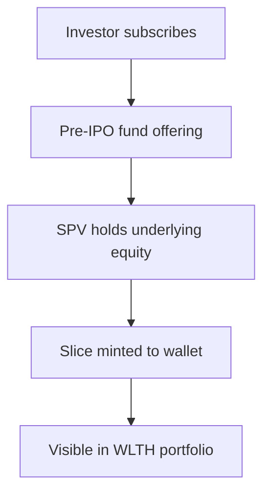

<Info>
  **Quick answer:** A **Slice** is an ERC-721 token on Base that gives you a contractual economic right to your share of a WLTH allocation in a private company. WLTH Corp. holds the underlying position; you do not become a shareholder. You can **hold, trade, or split** Slices when fund rules allow. Payouts from exits arrive in **USDC**.
</Info>

Slices are how WLTH turns illiquid private-market allocations into **fractional, transparent, tradable** positions. Instead of locking capital for years with no exit path, eligible holders can list Slices in the WLTH app when fund terms and buyer demand allow.

## What is a Slice?

A Slice is a **tokenized unit of ownership** representing your exact share in a deal or fund:

- Standard: **ERC-721** token on **Base** (Ethereum L2)
- Economic meaning: **tokenised economic exposure** to a WLTH allocation in a private company
- Not direct stock: no shareholder voting rights in the target company
- Backing: WLTH Corp. holds the underlying position per offering documents; your Slice is a contractual economic right

## How Slices are created

1. You **subscribe** to a live pre-IPO offering on WLTH.
2. Capital flows into a **fund structure** that holds verified underlying equity.
3. You receive a **Slice** proportional to your investment.
4. Slice metadata records your share, voting weight on exits, and status updates.

## What you can do with a Slice

| Action | Description |
| --- | --- |
| **Hold** | Maintain exposure until IPO, M&A, dividend, or other liquidity event |
| **Trade** | List in the WLTH app when fund terms permit ([how to sell](/investment/slices/buying-and-selling-slices)) |
| **Split** | Divide a Slice into smaller parts ([splitting Slices](/investment/slices/splitting-slices)) |
| **Gift** | Send a Slice to another person by email ([gifting Slices](/investment/slices/gifting-slices)) |
| **Vote** | Participate in community-led exit votes per deal terms |
| **Claim** | After unlock, claim the Slice to USDC from Portfolio ([Slice to public asset](/investment/guides/from-slice-to-public-asset)) |

## Payouts and exits

- After a liquidity event and the lock-up on WLTH's position ends, open **Portfolio** and tap **Claim**. Proceeds land as **USDC**.
- You can keep the USDC, or swap into a **public ticker** (for example SPCX) on [ST0x](https://www.st0x.io/) rails. That step is optional.
- **Exit votes:** Slice holders may vote on liquidity opportunities per deal terms.
- **Partial exits:** Slice metadata updates to reflect your remaining share.
- **Full exits:** Slice may be marked complete after final distribution.

The full path is in [From Slice to public asset](/investment/guides/from-slice-to-public-asset).

## Liquidity: what "tradable" really means

Slices are **designed** for flexibility, but liquidity is **conditional**:

- Fund-level **lockups** may block transfers after subscription.
- You need a **willing buyer** in the app.
- WLTH does **not** guarantee bids or repurchase your Slice.

Read the full [liquidity and lockups guide](/investment/guides/liquidity-lockups-and-trading-slices).

## WLTH Slice vs traditional private fund interest

| Topic | Traditional fund interest | WLTH Slice |
| --- | --- | --- |
| Proof of ownership | Paper / custodian records | On-chain record on Base |
| Minimum | Often \$10,000\+ | From **\$20** |
| Secondary sales | Rare, negotiated | In-app sales when eligible |
| Payouts | Fund admin distribution | USDC to wallet |
| Transparency | Periodic statements | On-chain provenance \+ app portfolio |

## Security and custody

- WLTH is **non-custodial**. Smart contracts handle transfers; WLTH does not hold your assets.
- Use **2FA** and consider a hardware wallet for larger holdings.
- Review [security best practices](/security-and-technology/security-best-practices).

## Related pages

- [From Slice to public asset](/investment/guides/from-slice-to-public-asset)
- [Slices overview](/investment/slices)
- [Buying and selling Slices](/investment/slices/buying-and-selling-slices)
- [Pre-IPO Access](/investment/exclusive-access/pre-ipo-access)
- [Support FAQ](/support/faq)

## FAQ

<AccordionGroup>
  <Accordion title="Is a Slice the same as a share of stock?">
    No. A Slice represents tokenized economic exposure through a fund structure. It is not a registered share on a public exchange.
  </Accordion>

  <Accordion title="Are Slices backed by real equity?">
    WLTH Corp. holds the underlying position for each offering. Your Slice is a contractual economic right to part of that allocation, not a share in the target company.
  </Accordion>

  <Accordion title="Can I sell my Slice anytime?">
    When fund terms allow and a buyer exists, yes, in the WLTH app. Lockups and low demand can prevent sales.
  </Accordion>

  <Accordion title="What blockchain are Slices on?">
    Base (Ethereum L2), as ERC-721 tokens.
  </Accordion>

  <Accordion title="How do I buy my first Slice?">
    Create an account, fund with USDC, browse [Pre-IPO Access](https://app.wlth.xyz/companies), and invest from \$20.
  </Accordion>

  <Accordion title="What fees apply?">
    Fees vary by offering and secondary activity in the app. See fund disclosures and [staking and fees](/investment/staking-and-fees) for platform context.
  </Accordion>
</AccordionGroup>
