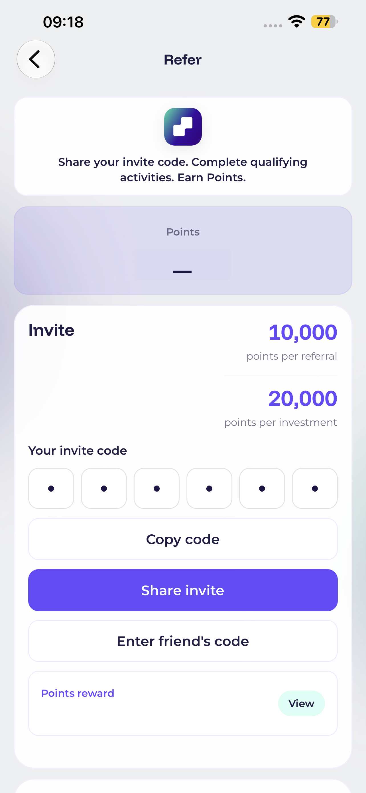
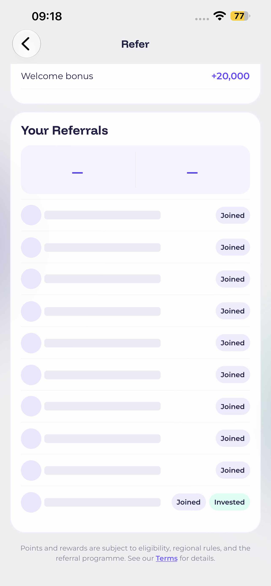

<Info>
  **Quick answer:** You get **10,000 points** when someone you invite joins. If that person invests, that referral is worth **20,000 points instead**. The 20,000 replaces the 10,000. It is not added on top (20,000 total, never 30,000). To join, they download the app via your invite link, create an account, and complete identity verification. Investing is an in-app Slice purchase of at least \$20. Web purchases do not count.
</Info>

**Referral joins: 10,000 points. Referral invests: 20,000 points for that referral (replaces the 10,000, not added to it).**

## Find your invite code

Tap the more icon in the bottom right of the app. Select **Referral**.

The **Refer** page shows **10,000 points per referral** and **20,000 points per investment**, your invite code, and the actions used to share it or enter a friend's code.

<Frame caption="The **Refer** page shows **10,000 points per referral** and **20,000 points per investment**, plus **Copy code**, **Share invite**, **Enter friend's code**, and **Points reward** with **View**.">
  
</Frame>

- **Copy code** copies your invite code.
- **Share invite** opens your device share sheet. Send the invite via AirDrop, Messages, WhatsApp, Telegram, or any other app on your device. The message pre-populates with your invite link.
- **Enter friend's code** is where you paste an invite code if someone referred you.
- **Points reward** with **View** opens the points reward details.

When someone opens your shared invite link, it prompts them to download the WLTH app, create an account, and complete identity verification. They can also copy the code and enter it in the app with **Enter friend's code**.

## Track your referrals

Scroll the **Refer** page to see **Welcome bonus** and **Your Referrals**.

<Frame caption="**Welcome bonus** shows **+20,000**. **Your Referrals** lists each friend with **Joined** status, or **Joined** and **Invested** when they have invested.">
  
</Frame>

- **Welcome bonus** displays **+20,000**.
- **Your Referrals** lists each person you referred. Rows show **Joined**, and **Invested** once that person has invested.

**Joined** is the 10,000-point stage. **Invested** is the 20,000-point stage for that same referral (replaces the 10,000, not added to it).

## What counts as a qualifying referral

Each referred person is one referral. Points depend on how far they get:

**Referral joins: 10,000 points.** They must complete both steps, in order:

1. Download the WLTH app using your referral link
2. Create an account and complete identity verification

**Referral invests: 20,000 points for that referral (replaces the 10,000, not added to it).** After joining, they make a Slice purchase inside the app. Web purchases do not qualify.

Simply downloading the app is not enough to count as joined. Identity verification is part of joining. The in-app purchase is what moves that referral from 10,000 to 20,000.

## Rules

* You (the referrer) get 10,000 points per referral when they join. If they invest, that referral is worth 20,000 points instead.
* The 20,000 is not added on top of the 10,000. It is 20,000 total for that referral, never 30,000.
* Referral joins: 10,000 points. Referral invests: 20,000 points for that referral (replaces the 10,000, not added to it).
* The referred user must be new to WLTH. Existing accounts do not qualify.
* The minimum qualifying purchase is \$20, completed inside the WLTH app.
* Self-referrals are not permitted.
* Each referred user is one referral. Joining credits 10,000. If they invest, that same referral becomes 20,000 rather than a second 10,000.
* Points are credited automatically. No manual steps required.
* Anti-abuse checks run continuously. Referrals identified as invalid or abusive will not qualify.
* If a qualifying purchase is refunded or reversed, associated referral rewards may be revoked.

## Redemption

Points are accruing now. Full redemption details will be announced soon. You will be able to exchange points for prizes, events, Slices, and more (subject to change). Every point you earn today counts.

## Points

Points are what the referral programme pays out. The conversion rate is fixed at **1,000 points = \$1**. Your balance is visible in the app at all times, and points never expire.

### Points earning summary

| Action | Points for that referral |
| --- | --- |
| Referral joins | 10,000 |
| Referral invests | 20,000 (replaces the 10,000, not added to it) |

There is no cap on how many people you can refer. Two referrals who both invest are 20,000 + 20,000 = 40,000. One referral who joins and then invests is 20,000 total, never 30,000.

<Warning>
  Points are not XP. XP is a separate currency used only in Earn to Own campaigns. XP determines your leaderboard rank in a campaign and does not convert to points. Points do not affect your Earn to Own position. See [Earn to Own](/earn-to-own) for how XP works.
</Warning>

## Common questions

<AccordionGroup>
  <Accordion title="Do points expire?">
    No.
  </Accordion>

  <Accordion title="Is there a limit on how many people I can refer?">
    No. Each person who joins earns you 10,000 points. If they invest, that referral is worth 20,000 points instead of 10,000.
  </Accordion>

  <Accordion title="If my friend joins and then invests, do I get 30,000 points?">
    No. Referral joins: 10,000 points. Referral invests: 20,000 points for that referral (replaces the 10,000, not added to it). The total for that referral is 20,000, never 30,000.
  </Accordion>

  <Accordion title="Can I refer myself with a second account?">
    No. Self-referrals are not permitted and anti-abuse checks run continuously.
  </Accordion>

  <Accordion title="My friend signed up but I have not received points.">
    Joining requires the app download via your link, an account, and identity verification. If they have completed those steps and points still have not credited, contact [Support](https://app.wlth.xyz/support). Investing later upgrades that same referral from 10,000 to 20,000.
  </Accordion>

  <Accordion title="Can I earn points from Earn to Own missions?">
    No. Earn to Own missions award XP, which is a separate currency.
  </Accordion>

  <Accordion title="What if I signed up on the web?">
    Web accounts work for browsing and purchasing, but referral rewards require the app. Download the app and sign in with the same account.
  </Accordion>
</AccordionGroup>

Need help? Open [Support](https://app.wlth.xyz/support) in the WLTH app.
