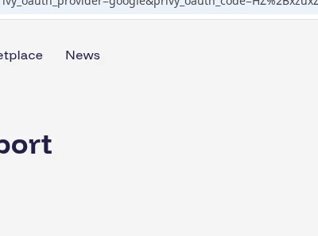
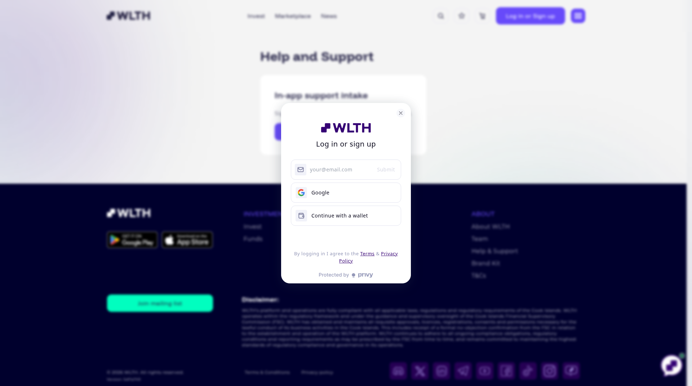
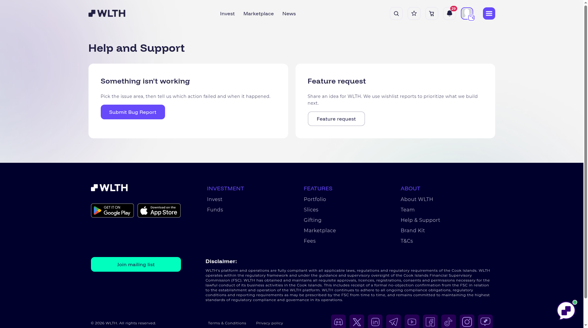
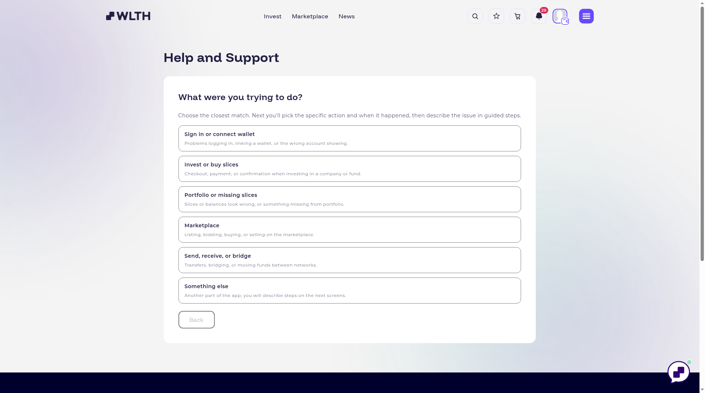
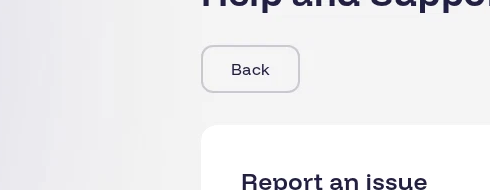
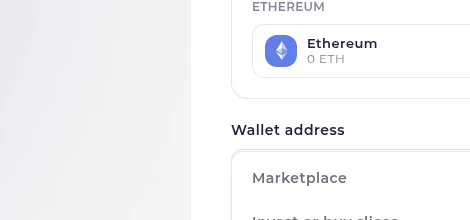
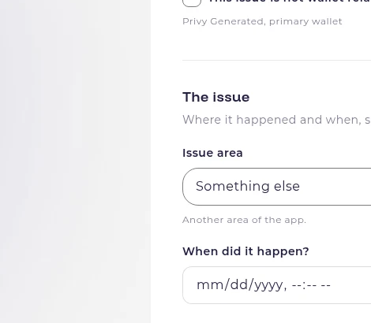
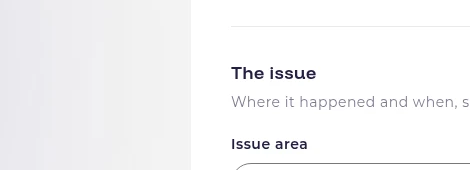
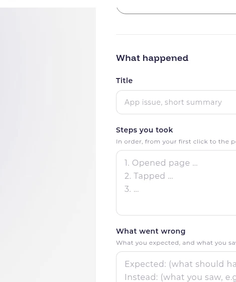
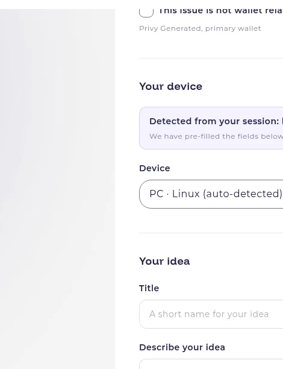

<Info>
  **Quick answer:** Raise a bug report or feature request at [app.wlth.xyz/support](https://app.wlth.xyz/support). You must be signed in. Open **Support** from the hamburger menu (top right), choose **Help & Support** under ABOUT in the footer, or go to the link directly. Pick **Something isn't working** to submit a bug, or **Feature request** for a wishlist idea. Fill in the form, attach screenshots if you have them, then submit.
</Info>

Raise a request in the WLTH app. Discord is not used for support.

## Raise a request

<Steps>
  <Step title="Open Support">
    Get to Help and Support in any of these ways:

    - Tap the hamburger menu (top right, **Open navigation menu**) and pick **Support**
    - Choose **Help & Support** under ABOUT in the footer
    - Go to [app.wlth.xyz/support](https://app.wlth.xyz/support)

    <Frame caption="Hamburger menu (top right) with **Support**, or go to app.wlth.xyz/support">
      
    </Frame>
  </Step>

  <Step title="Sign in">
    You must be signed in. If you are logged out, you see an **In-app support intake** card with a **Sign in** button. Sign in with email, Google, or a wallet.

    <Frame caption="Logged-out users see **In-app support intake**. Sign in with email, Google, or a wallet.">
      
    </Frame>
  </Step>

  <Step title="Choose a bug report or feature request">
    The Help and Support page has two cards:

    - **Something isn't working**, then **Submit Bug Report**
    - **Feature request**, then the **Feature request** button

    <Frame caption="Help and Support with **Submit Bug Report** and **Feature request**">
      
    </Frame>
  </Step>

  <Step title="Pick the closest area">
    For a bug report, **What were you trying to do?** Pick the closest match:

    - **Sign in or connect wallet**
    - **Invest or buy Slices**
    - **Portfolio or missing Slices**
    - **Marketplace**
    - **Send, receive, or bridge**
    - **Something else**

    <Frame caption="Choose the closest area, then you fill in the action and when it happened">
      
    </Frame>
  </Step>

  <Step title="Set the report type">
    The **Report an issue** form has a report type toggle: **Bug report** or **Wishlist idea**. **Your account** is pre-filled from your session.

    <Frame caption="Report type toggle: **Bug report** or **Wishlist idea**. **Your account** is pre-filled.">
      
    </Frame>
  </Step>

  <Step title="Choose the issue area">
    Under **The issue**, set **Issue area**.

    <Frame caption="**Issue area** on the Report an issue form">
      
    </Frame>
  </Step>

  <Step title="Fill in when, where, and your device">
    Fill **When did it happen?** and **Page or screen (optional)**. **Your device** is auto-detected. Change it if it is wrong.

    Next to the pre-filled wallet address, tick **This issue is not wallet related** when the issue is not about a wallet.

    <Frame caption="**The issue** fields and auto-detected **Your device**. Tick **This issue is not wallet related** when it applies.">
      
    </Frame>
  </Step>

  <Step title="Choose the action">
    Set **Action** to the thing you were doing when it failed.

    <Frame caption="**Action** on the Report an issue form">
      
    </Frame>
  </Step>

  <Step title="Describe what happened and submit">
    Under **What happened**, fill:

    - **Title**
    - **Steps you took** (in order, from the first click to where it failed)
    - **What went wrong** (what you expected vs what you saw)
    - **Screenshots (optional)**: JPEG, PNG, or WebP, up to 3 files, 5 MB each

    Then press **Submit bug report**.

    <Frame caption="**What happened**: title, steps, what went wrong, optional screenshots, then **Submit bug report**">
      
    </Frame>
  </Step>

  <Step title="Submit a wishlist idea">
    Switch the toggle to **Wishlist idea**. Fill **Title** and **Describe your idea**. Attach optional screenshots, then press **Submit idea**.

    <Frame caption="**Wishlist idea**: **Title**, **Describe your idea**, optional screenshots, then **Submit idea**">
      
    </Frame>
  </Step>
</Steps>
